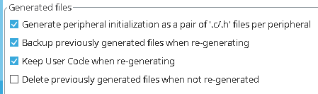

# MMS3 Embedded headstart board software base (For HAL)

This repo contains an already set up CubeMX project for the embedded headstart board. Chainbus pins are already configured. If you are going to use altmode pins, just configure them as you need.

### Before genertion of code

Check these two things:

1. Make sure the options in Project Manager->Code Generator are set up just like above

2. In Project Manager->Project make sure that toolchain/IDE of your choice is correct (for now I recommand STM32CubeIDE)
